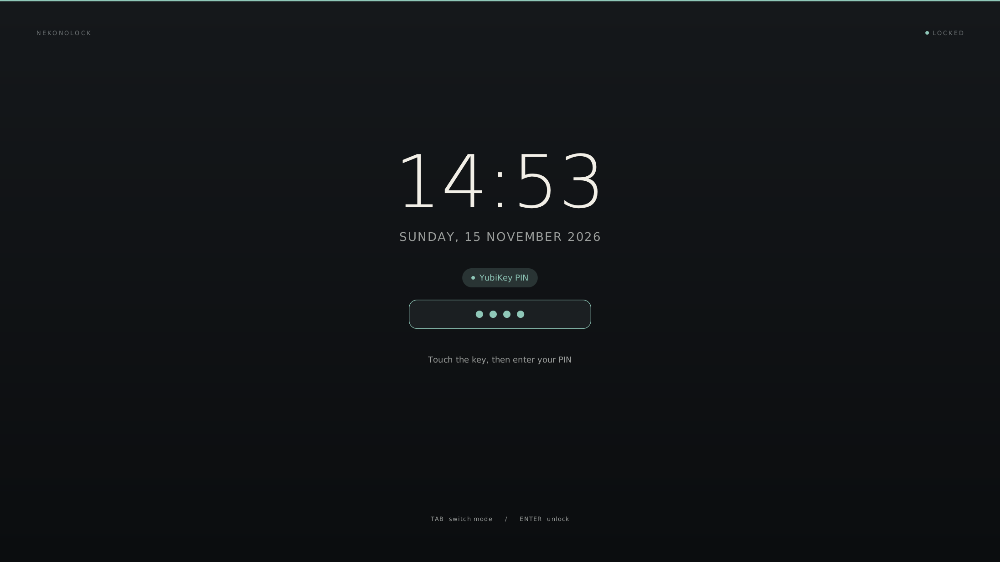
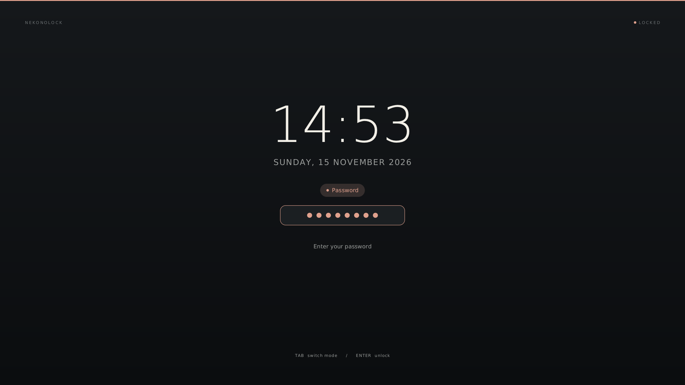
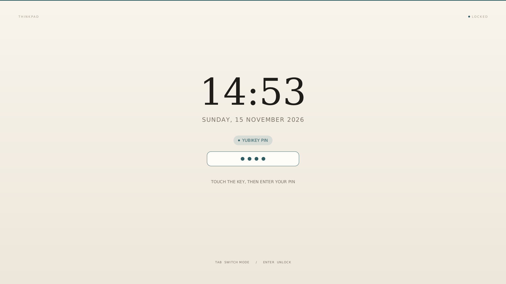
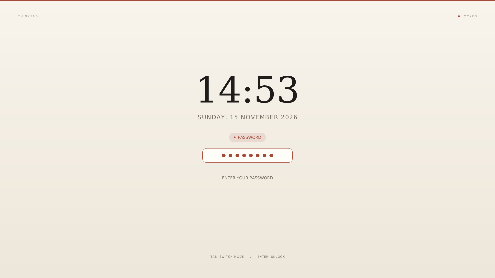

# nekonolock

Sway (wlroots) 用の小さなスクリーンロッカー。YubiKey の OpenPGP applet と
パスワードの両方で解除でき、scdaemon と pcscd のカード取り合いを
構造的に起こさないことを目的とする。

**状態: v0.2.1 リリース済み。UI は Ink テーマ、HiDPI、無操作時の純黒に
対応。テキストは共通のベースラインに載せ、小文字と降下部を正しく描く。
ソースには Phase 7 の sudo 用 PAM モジュール（`pam_nekonolock.so`）も
含む。package への同梱は次回の tag から。**

既定は濃いチャコールの **Ink**。明るい **Paper** は `[ui]` の色と時計フォントを
差し替えて使う。どちらも上端の accent line、モード capsule、入力欄の枠で
PIN / Password を区別する。

| Ink / PIN | Ink / Password |
|---|---|
|  |  |
| **Paper / PIN** | **Paper / Password** |
|  |  |

画像は `cargo run -p nekonolock --example preview` で `docs/images/` に再生成する。
HiDPI は `wl_output.scale` の整数倍でバッファを描き、`set_buffer_scale` で
論理サイズに戻す。無操作時は `[ui] blank_after_sec` 秒で純黒にし、キー入力で戻す。

`packaging/` に pacman package と ansible role のステージングを置いている。
package は `nekonolock` / `nekonolock-auth`、`/etc/pam.d/nekonolock`、
`SOCK_SEQPACKET` の systemd user unit 2 本を含む。ansible role は package
導入、PAM 配置、socket の enable、swayidle の差し替えを行う。

```sh
# 単体テストと結合テスト（モックバックエンド）
cargo test --workspace
cargo test -p nekonolock-auth --features mock-card,mock-pam

# 手元でヘルパを起動する場合
cargo run -p nekonolock-auth -- --config ~/.config/nekonolock/config.toml

# ロック画面（別端末から Sway 上で）
cargo run -p nekonolock

# README 用のプレビュー画像を docs/images/ に書き出す
cargo run -p nekonolock --example preview

# Sway headless の E2E（Docker + モック認証ヘルパ）
bash spike/03-lock-ui-sway.sh

# package と ansible role の E2E（Arch Linux コンテナ）
bash spike/04-package-ansible.sh
```

ビルドには `libxkbcommon` の開発用ファイル（Arch: `libxkbcommon`、
Debian/Ubuntu: `libxkbcommon-dev`）が要る。実行時は `[ui] font` /
`[ui] clock_font` のフォントと `nekonolock-auth` の socket activation を
用意する（既定は `ttf-dejavu`）。pacman package と ansible role の内容は
[packaging/README.md](packaging/README.md) を参照。

- 設計: [docs/design.md](docs/design.md)
- 決定と却下案: [docs/decisions.md](docs/decisions.md)
- 配布物: [packaging/README.md](packaging/README.md)
